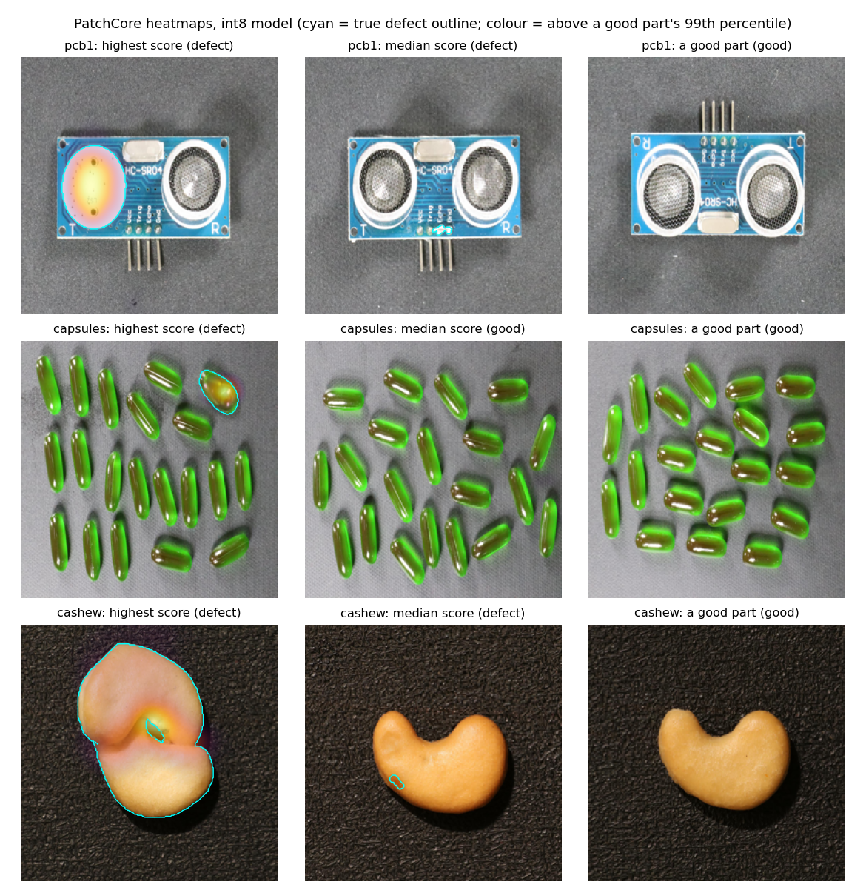
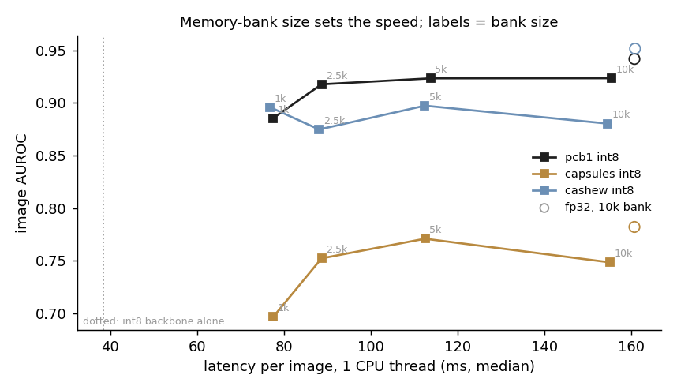
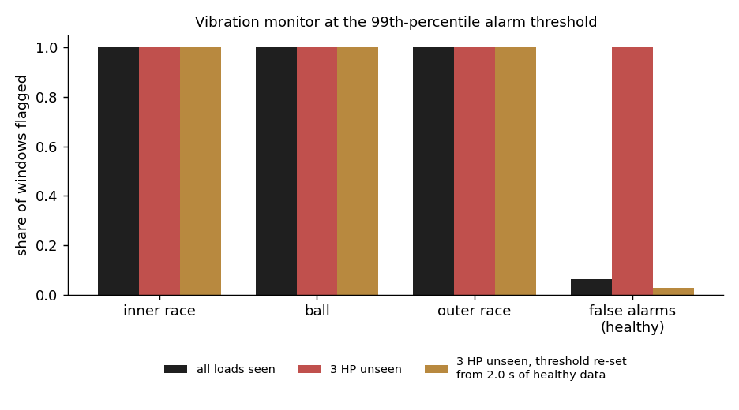

# Industrial anomaly detection on the edge

[](https://github.com/Praruj/industrial-edge-anomaly/actions/workflows/ci.yml)


[](LICENSE)

Two detectors that learn only from **healthy** equipment and flag anything else, then get shrunk to run on a
small CPU:

- **Visual inspection** of products (PCBs, capsules, cashews) with PatchCore on public VisA images.
- **Vibration monitoring** of motor bearings on the CWRU dataset, with a 4.5k-parameter autoencoder.

Every number below was measured on a laptop CPU **limited to one thread**, as a stand-in for an edge device.

| | Model on disk | Latency | Result |
|---|---|---|---|
| Visual inspection, pcb1, int8 | 2.9 MB + 1.9 MB memory bank | **89 ms / image** | image AUROC 0.918, pixel AUROC 0.993 |
| Same, fp32 reference | 11.1 MB + 7.7 MB | 161 ms / image | image AUROC 0.942, pixel AUROC 0.996 |
| Vibration monitor, int8 | **11 KB** | 2.2 ms features + 0.04 ms model per 0.17 s window | catches every fault window; 2.8% false alarms after recalibration |



## What I found

**1. On the edge, the nearest-neighbour search is the bottleneck, not the network.**
After int8 quantization the ResNet18 backbone takes 38 ms per image. Comparing its 1,024 patches with a
10,000-entry memory bank adds another ~115 ms. Shrinking the memory bank to 2,500 patches (greedy coreset,
so it still covers the variety of good parts) gives most of the speed-up for little accuracy:

| Category | fp32, 10k bank | int8, 10k bank | **int8, 2.5k bank** | int8, 1k bank |
|---|---|---|---|---|
| pcb1 (electronics) | 0.942 / 161 ms | 0.924 / 155 ms | **0.918 / 89 ms** | 0.885 / 77 ms |
| capsules (pharma) | 0.782 / 161 ms | 0.749 / 155 ms | **0.752 / 89 ms** | 0.697 / 78 ms |
| cashew (food) | 0.952 / 161 ms | 0.880 / 154 ms | **0.875 / 88 ms** | 0.896 / 77 ms |

*Image AUROC / median latency per image. 100 defective and 100 good test images per category, from VisA's
official split; the detector never sees a defect during training.*



**2. int8 is 4× smaller, but it is not free.** Accuracy drops by 0.02 to 0.07 image AUROC, most on cashew.
Calibration used good parts only, as it would on a real line. If that drop matters, the next things to try
are keeping the last block in fp16, or quantization-aware fine-tuning.

**3. The public bearing dataset has a sample-rate trap.** CWRU's healthy recordings are stored next to 12 kHz
fault recordings, but their structural resonances (148, 161, 192, 330, 360, 390 Hz) only line up with the
fault files when read at **48 kHz**. This code resamples them to 12 kHz. Read naively, every frequency feature
for the healthy class is off by 4×.

**4. A perfect score can still be useless in production.** All models reach AUROC 1.0 on CWRU, even with
white noise ten times the power of the healthy signal and with loudness-blind features. That says more about
the dataset (healthy and faulty data come from different recording sessions) than about the models, so I
don't treat it as an achievement. The useful test is an operating point the model never saw:

| Vibration monitor (autoencoder) | Faults caught | False alarms on healthy data |
|---|---|---|
| Trained on all four motor loads | 100% | 6.3% |
| 3 HP load never seen in training | 100% | **100%** |
| Same, alarm threshold re-set from **2 s** of healthy 3 HP data, no retraining | 100% | **2.8%** |

The ranking stayed perfect, but a fixed threshold flagged every healthy window at the new load. The fix
is operational, not a bigger model: recalibrate the threshold when a machine changes operating point.



## How it works

**Visual inspection: PatchCore** ([Roth et al., 2022](https://arxiv.org/abs/2106.08265)), sized down.
- ImageNet ResNet18, layer2 + layer3 features, each averaged over its 3×3 neighbourhood, on a 32×32 grid of
  384-dimensional patches per 256×256 image.
- Memory bank: 256 random patches from each good training image, then a greedy k-centre coreset. The greedy
  order is nested, so one run yields every bank size in the sweep.
- Score: distance from each test patch to its nearest bank entry. The image score is the maximum, and the
  heatmap is the upsampled, Gaussian-smoothed patch scores.
- Edge: backbone exported to ONNX, static int8 (QDQ, per-channel weights) calibrated on 32 good images, and
  the bank stored as float16.

**Vibration monitoring.**
- Drive-end acceleration, 2,048-sample windows (0.17 s at 12 kHz) with 50% overlap.
- 37 features: log RMS, log peak, crest factor, kurtosis, skewness, plus 32 log band energies.
- Isolation Forest baseline and a 4.5k-parameter autoencoder trained on healthy windows only (chronological
  split: 50% train, 20% for the alarm threshold, 30% test). The alarm fires above the 99th percentile of
  held-out healthy scores.
- Edge: the autoencoder and its scoring step exported as one ONNX graph that outputs the anomaly score, then
  dynamic int8.

## Limitations

- The laptop CPU (Intel Core, 1 thread) is a stand-in. Run `scripts/run_vision.py` on the target device
  before quoting latency for it.
- Small defects are hard at 256×256. In the heatmaps above, the median-scoring defects on pcb1 and cashew are
  tiny and barely light up. Higher resolution or tiling would help, at a latency cost.
- capsules (0.78 image AUROC) is the weakest category; a stronger backbone such as WideResNet50 would raise it
  but is roughly 6× heavier.
- Test sets are small (200 images per category, 36 healthy windows in the unseen-load test), so differences
  of a few hundredths are within noise.
- CWRU is saturated, as noted above. The vibration code is written so a harder dataset (for example NASA IMS
  run-to-failure or MIMII machine sounds) can replace it.

## Reproduce

```bash
python -m venv .venv && .venv/Scripts/activate           # Windows; use bin/activate elsewhere
pip install torch==2.5.1 torchvision==0.20.1 --index-url https://download.pytorch.org/whl/cpu
pip install -r requirements.txt

# data (not in the repo)
#   VisA (CC BY 4.0): https://amazon-visual-anomaly.s3.us-west-2.amazonaws.com/VisA_20220922.tar
#     extract split_csv/ and the category folders into data/raw/visa/VisA/
#   CWRU: files 97-100, 105-108, 118-121, 130-133 from
#     https://engineering.case.edu/bearingdatacenter/download-data-file into data/raw/cwru/

python scripts/run_vibration.py      # a few minutes on a laptop CPU
python scripts/run_vision.py         # ~1 h on a laptop CPU for three categories
python scripts/report.py             # figures in outputs/figures
pytest -q                            # 11 tests on synthetic data, no downloads
```

```
src/iea/vision.py      VisA loading, PatchCore features, coreset, scoring, heatmaps
src/iea/vibration.py   CWRU loading and resampling, windows, features, splits, noise
src/iea/models.py      tiny autoencoder
src/iea/edge.py        ONNX export, int8 quantization, latency and size measurement
scripts/               run_vision.py, run_vibration.py, report.py
outputs/               results.json for each track, figures
```

## Data and credits

- **VisA**: Zou et al., *SPot-the-Difference Self-Supervised Pre-training for Anomaly Detection and
  Segmentation*, ECCV 2022. CC BY 4.0.
- **CWRU Bearing Data Center**, Case Western Reserve University.
- **PatchCore**: Roth et al., *Towards Total Recall in Industrial Anomaly Detection*, CVPR 2022.

---

## 日本語概要

正常データだけで学習し、それ以外を異常として検知する2つのモデルを、小型CPUで動くように軽量化したプロジェクトです。

- **外観検査**：公開データセットVisA（基板・カプセル・カシューナッツ）でPatchCoreを使用。int8化により
  モデルは11.1 MBから2.9 MBに、処理時間は1スレッドで161 msから89 msに短縮（pcb1、画像AUROC 0.918）。
- **振動監視**：CWRU軸受データで4.5千パラメータのオートエンコーダを使用。int8モデルは11 KB。

主な発見：
1. エッジでは、ネットワークよりもメモリバンクとの最近傍探索が処理時間の大半を占める。
2. int8化はサイズを4分の1にするが、精度はAUROCで0.02〜0.07低下する。
3. CWRUの正常データは48 kHzで記録されており、12 kHzとして読むと周波数特徴が4倍ずれる。
4. 学習時にない負荷条件では正常データの100%が誤報になるが、2秒分の正常データでしきい値を再設定するだけで
   2.8%まで下がる（再学習なし）。
